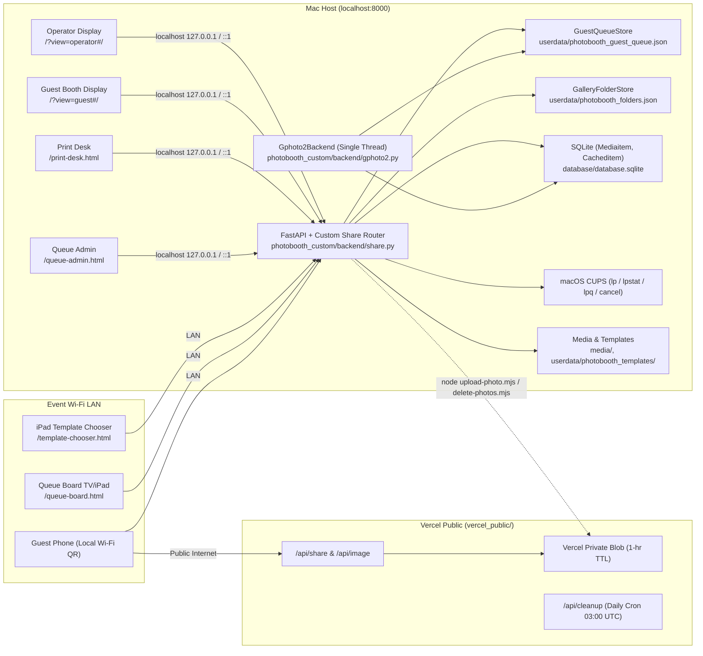

# Current-State Audit — Photobooth Platform (Phase 0 Baseline)

> **Date:** 23 November 2026  
> **Scope:** ระบบใช้งานจริงบน Mac (`photobooth_custom/` + `config/` + `scripts/` + `run.sh`) และเว็บสาธารณะ (`vercel_public/`)

---

## 1. Environment & Dependency Versions

| Component | Verified Version |
|---|---|
| Operating System | macOS 27.0 (Build `26A428`) |
| Python | `3.12.14` (venv) |
| Node.js | `v24.14.0` |
| Photobooth Core | `photobooth-app` v9 (`./venv/bin/photobooth`) |
| Web Framework | FastAPI `0.141.1` |
| ORM / Database | SQLAlchemy `2.0.54` + SQLite (`database/database.sqlite`) |
| Imaging | Pillow `12.3.0` |
| Camera Driver | `python-gphoto2` `2.6.4` (`libgphoto2`, Canon USB/PTP) |
| Cloud Storage SDK | `@vercel/blob` `^2.8.0` |

---

## 2. Architecture Map

### Deployment Mechanism
- `run.sh` เรียก `scripts/install_customizations.sh` ทุกครั้งก่อนเปิด `./venv/bin/photobooth` เพื่อคัดลอกไฟล์จาก `photobooth_custom/` เข้า `site-packages` (`web/frontend`, `photobooth/routers/api`, `photobooth/services`, `photobooth/services/backends`) และหยุด `ptpcamerad` ชั่วคราวเพื่อให้ `libgphoto2` คุมกล้อง Canon ได้
- `vercel_public/` เป็น Root Directory แยกสำหรับ Deploy บน Vercel (ไม่มีสิทธิ์ควบคุมกล้อง/เครื่องพิมพ์)

---

## 3. API Route Inventory (`/api/share/*` & `vercel_public/api/*`)

### 3.1 Custom Backend Routes (`photobooth_custom/backend/share.py`)

| Method & Path | Access Scope | Purpose | Notes / Phase 1 Target |
|---|---|---|---|
| `GET /api/share/health` | Public / LAN | ตรวจสุขภาพระบบย่อ (DB, stores, disk, camera, unknown jobs) | เพิ่มใน Phase 0 |
| `GET /api/share/preflight` | Localhost only | ตรวจความพร้อมก่อนเปิดงานแบบละเอียด | เพิ่มใน Phase 0 |
| `GET /api/share/camera-health` | LAN | สถานะ backend กล้อง + autodetect | มี `gphoto2` cache 4 วินาที |
| `GET /api/share/capture-state` | LAN | สถานะ `capture_busy` และ `shutter_locked` | ไม่เรียก USB autodetect |
| `GET /api/share/hardware/cameras` | LAN | รายการกล้อง Canon ที่พบ | ใช้ cache 4 วินาที |
| `GET /api/share/hardware/printers` | LAN | รายการเครื่องพิมพ์ CUPS และโปรไฟล์ | อ่านจาก `lpstat` + JSON |
| `GET /api/share/guest-queue` | LAN | สถานะคิวปัจจุบัน + sync media + CUPS states | แก้ TOCTOU race แล้ว |
| `GET /api/share/guest-queue/report` | LAN | สถิติคิวและผู้มาใช้แยกรอบ | Read-only |
| `GET /api/share/print_queue` | LAN | คิวพิมพ์ CUPS + `unknown_print_jobs` | ใช้โดย Print Island & Queue |
| `GET /api/share/gallery-folders` | LAN | โฟลเดอร์โครงการและวันที่ | Read-only |
| `GET /api/share/gallery-folders/{id}/delete-preview` | LAN | สรุปจำนวนภาพก่อนลบโฟลเดอร์ | Read-only |
| `GET /api/share/templates` | LAN | รายการเทมเพลตที่เปิดใช้งาน | ใช้โดย iPad chooser |
| `GET /api/share/templates/{id}/asset/{type}` | LAN | ภาพ background/overlay ของเทมเพลต | `background` / `overlay` |
| `GET /api/share/template-sources/{id}` | LAN | ภาพต้นฉบับในชุดภาพสำหรับจัดเทมเพลต | สูงสุด 6 ภาพ |
| `GET /api/share/template-chooser-qr.svg` | LAN | QR เปิดหน้าเลือกกรอบบน iPad | เรียก `scripts/qr-svg.mjs` |
| `GET /api/share/download/{id}` | LAN | Pluggy download links | Read-only |
| `GET /api/share/download-image/{id}` | LAN | ดาวน์โหลดไฟล์ภาพ (ตัดครึ่ง 2×6 อัตโนมัติถ้าเป็น `two_up`) | ไม่แก้ต้นฉบับสำหรับพิมพ์ |
| `GET /api/share/download-page/{id}` | LAN | หน้าเว็บดาวน์โหลดบน Wi-Fi ท้องถิ่น | HTML + Web Share |
| `GET /api/share/qr/{id}.svg` | LAN | QR (Cloud URL ถ้าพร้อม หรือ Local URL) | คืน 410 หากลิงก์หมดอายุ |
| `GET /api/share/cloud-status/{id}` | LAN | สถานะอัปโหลด Cloud ของภาพ | อัปโหลดซ้ำตาม retry |
| `POST /api/share/guest-queue/{code}/template` | LAN (Guest iPad) | เลือกกรอบสำหรับคิวที่กำลังถ่ายก่อนช็อตแรก | ตรวจ active + unshot |
| `POST /api/share/compose-template` | LAN *(Phase 1: move to auth)* | บันทึกภาพที่จัดเทมเพลตบน Canvas | ใช้ใน Studio |
| `POST /api/share/compose-template-from-files` | Localhost only | นำเข้าภาพจาก Mac โดยไม่ผูกคิว | Rollback ได้หากล้มเหลว |
| `POST /api/share/actions/{index}`, `/actions/latest/{index}`, `/actions/{id}/{index}` | Localhost only | เรียก Share action พร้อมตรวจ parameter schema | ป้องกัน Command Injection |
| `POST /api/share/airdrop/latest`, `/airdrop/{id}` | Localhost only | เปิด AirDrop/Finder บน Mac | Mac only |
| `POST /api/share/guest-queue` | Localhost only | ออกบัตรคิวใหม่ | ผูก active project folder |
| `POST /api/share/guest-queue/{code}/ticket-airdrop` | Localhost only | ส่งบัตรคิว PNG ผ่าน AirDrop | Mac only |
| `POST /api/share/guest-queue/categories` | Localhost only | เพิ่มประเภทคิว | Prefix 2–8 ตัวอักษร |
| `POST /api/share/guest-queue/reset` | Localhost only | ปิดรอบเก่าและเริ่มรอบใหม่ที่ 01 | ห้ามรีเซ็ตเมื่อมีงานค้าง |
| `POST /api/share/guest-queue/{code}/start` | Localhost only | เริ่มถ่ายคิว | ล็อกคิวซ้อนภายใน `_lock` |
| `POST /api/share/guest-queue/{code}/call` | Localhost only | บันทึก event เรียกเสียงคิว | ไม่เปลี่ยนสถานะคิว |
| `POST /api/share/guest-queue/{code}/skip` | Localhost only | ข้ามคิวแรกไปท้ายแถว | คงเลขเดิม |
| `DELETE /api/share/guest-queue/{code}` | Localhost only | ยกเลิกคิวที่ยังไม่ถ่าย | ไม่ใช้เลขซ้ำ |
| `POST /api/share/guest-queue/print-jobs/resolve` | Localhost only | ยืนยันผลพิมพ์ `unknown` (`printed` / `canceled`) | เพิ่มใน Phase 0 |
| `DELETE /api/share/print_queue/{job_id}`, `POST /print_queue/clear` | Localhost only | ยกเลิกงานพิมพ์ CUPS | อัปเดต `GuestQueueStore` |
| `POST /api/share/approval/{capture_id}/{decision}` | Localhost only | ยืนยัน/ถ่ายใหม่ภาพขณะรออนุมัติ | ล็อกด้วย `_approval_action_lock` |
| `POST /api/share/templates`, `/{id}/activate`, `DELETE /{id}`, `POST /{id}/restore` | Localhost only | จัดการเทมเพลต | ป้องกันแก้/ลบขณะคิวใช้งาน |
| `POST /api/share/printer-profiles`, `/{id}/activate`, `DELETE /{id}`, `POST /{id}/test`, `POST /print/{id}` | Localhost only | จัดการโปรไฟล์เครื่องพิมพ์ & ส่งพิมพ์ | ตรวจ `lpstat -p` ก่อนส่ง |
| `POST /api/share/gallery-folders`, `PUT /active`, `PUT /media/{id}`, `POST /{id}/import-unassigned`, `DELETE /{id}` | Localhost only | จัดการโฟลเดอร์โครงการ & ลบภาพพร้อมสำรอง | สำรองลง `recycle/` ก่อนลบ |
| `POST /api/share/cloud-share/{id}` | Localhost only | สั่งอัปโหลดหรือต่ออายุ QR ออนไลน์ | ไม่บล็อกหน้างาน |

### 3.2 Vercel Public Routes (`vercel_public/api/*`)

| Route | Auth | Purpose |
|---|---|---|
| `GET /api/share?token=...` | Signed HMAC-SHA256 Token (TTL 1h) | หน้าแสดงและดาวน์โหลดภาพสำหรับผู้ใช้ |
| `GET /api/image?token=...` | Signed HMAC-SHA256 Token (TTL 1h) | Stream ภาพ JPEG จาก Vercel Private Blob |
| `GET /api/cleanup` | `Authorization: Bearer $CRON_SECRET` (`timingSafeEqual`) | Cron ลบไฟล์หมดอายุบน Blob รายวัน (`0 3 * * *`) |

---

## 4. State Transition Maps

### 4.1 Queue & Capture Lifecycle
- `waiting` → `shooting` (`POST /start`; ล้าง `template_id` เดิมหากคิวเคยถูกสร้างจากเวอร์ชันเก่า)
- `waiting` / `shooting (before first shot)` → `canceled` (`DELETE /guest-queue/{code}`)
- `shooting` → `ready` (เมื่อครบชุดภาพและมี collage ใน `set_media()` หรือ `notify_job_completed()`)
- `shooting` (aborted/incomplete while workflow idle) → `waiting` (`release_incomplete_job`)
- `ready` → `printing` (`record_print()`) → `printed` (เมื่อ CUPS รายงาน completed หรือเจ้าหน้าที่ยืนยันผล `unknown` เป็น `printed`)
- `printing` → `ready` / `printed` (เมื่อยกเลิกงานพิมพ์ล่าสุด โดยคง `"printed"` หากเคยมีงานพิมพ์สำเร็จก่อนหน้า)

### 4.2 Print Job States
- `queued` (เพิ่งส่งเข้า CUPS และได้ `cups_id`) → `printing` (ปรากฏใน `lpstat -W not-completed`) → `printed` (ปรากฏใน `lpstat -W completed`)
- หาก `lp` ไม่คืน `cups_id` หรือหายจาก CUPS เกิน 15 วินาทีโดยไม่ปรากฏใน `completed` → `unknown`
- **`unknown` Reconciliation (Phase 0):** ระบบ **ไม่สั่งพิมพ์ซ้ำอัตโนมัติ** และไม่อนุญาตให้เปิดรอบใหม่หรือลบโฟลเดอร์ที่มีภาพค้าง จนกว่าเจ้าหน้าที่จะตรวจกระดาษจริงแล้วกด **"ยืนยันว่าพิมพ์ออกแล้ว"** (`printed`, `operator_verified=True`) หรือ **"ยกเลิกงานนี้"** (`canceled`)
- **ข้อสังเกต:** สถานะ `printed` จาก CUPS หมายถึง CUPS ส่งข้อมูลเข้าสปูลเลอร์/เครื่องพิมพ์เสร็จสิ้น ไม่ได้ตรวจเซ็นเซอร์กระดาษออกจริงจากตัวเครื่องพิมพ์

### 4.3 Cloud Upload Lifecycle
- `pending` → `uploading` → `ready` (TTL 3600s) → `expired` (เข้าถึงไม่ได้ทันทีที่หมดอายุ; เจ้าหน้าที่กดสร้างใหม่ได้)
- หากอัปโหลดพลาด → `failed` (ตั้ง `retry_at` +30s เพื่อลองใหม่เมื่อเปิดดูภาพ) — ไม่กระทบไฟล์บน Mac และงานพิมพ์

---

## 5. Media Lineage & Storage

| Artifact Type | Path / Storage | Lifecycle |
|---|---|---|
| Raw/processed captures & collages | `media/` + `database/database.sqlite` (`Mediaitem`) | เก็บถาวรจนกว่าจะลบจากแกลเลอรีหรือลบโฟลเดอร์ (สำรองลง `recycle/photobooth-folders/`) |
| Thumbnails / Previews | `cache/` + `database/database.sqlite` (`Cacheditem`) | ลบทั้ง DB row และไฟล์จริงเมื่อลบโฟลเดอร์ |
| Queue & Folder Metadata | `userdata/photobooth_guest_queue.json`, `userdata/photobooth_folders.json` | Atomic temp-replace; หากไฟล์เดิมเสียหายจะสำรอง `.corrupt` และหยุดเพื่อกันล้างข้อมูล |
| Printer Profiles & Cloud Records | `userdata/photobooth_printers.json`, `userdata/photobooth_cloud_shares.json` | Lock-protected atomic write |
| Custom Templates & Assets | `userdata/photobooth_templates/` | ป้องกันแก้/ลบระหว่างคิวกำลังใช้งาน |
| AirDrop Queue Tickets | `userdata/queue_tickets/` | PNG 900×1500 สร้างเมื่อกดส่ง AirDrop |

---

## 6. Known Failure Modes & Technical Debt for Future Phases

1. **JSON Persistence vs Transactional SQLite (Target: Phase 1):** ปัจจุบัน `GuestQueueStore` และ `GalleryFolderStore` ใช้ไฟล์ JSON แยกจาก SQLite (`Mediaitem`) แม้จะมี `RLock` + atomic rename + `.corrupt` backup แล้ว แต่การผูกสถานะข้ามตาราง (เช่น Queue ↔ Media ↔ Print ↔ Cloud Outbox) ใน Phase 1 ควรย้ายสู่ SQLite WAL ด้วย transaction เดียวกัน
2. **Localhost-only Auth Model (Target: Phase 1):** ปัจจุบันจำกัด Operator ด้วย `_require_localhost` (เหมาะสมกับ Mac เครื่องเดียว) หากในอนาคตต้องใช้ iPad เป็นหน้าจอ Operator/Print Desk ผ่าน Wi-Fi จำเป็นต้องเพิ่ม Session/Token Auth + Role-Based Access Control (RBAC) + Audit Log และควรย้าย `POST /compose-template` เข้าใต้ Auth
3. **Cloud Upload Without Persistent Outbox Worker (Target: Phase 1/4):** ปัจจุบัน retry เฉพาะตอนเปิดหน้าดูภาพหรือ poll `cloud-status`; ควรมี Background Outbox Worker เมื่อ Wi-Fi กลับมาออนไลน์
4. **Live View Hardware Baseline (Target: Phase 0 Hardware Drill / Phase 3):** ระบบตั้งค่า Canon ผ่าน `gphoto2` ที่ 25 FPS loop (มี `_liveview_grace_until` 8 วินาทีและ USB reset recovery) แต่ยังต้องวัด latency, FPS จริง และความเสถียรข้ามวันกับกล้อง Canon ตัวจริงที่ใช้ในงาน

---

## 7. Hardware-in-the-Loop Test Checklist (ต้องตรวจหน้าเครื่องจริง)

- [ ] ทดสอบกล้อง Canon จริง: เปิด Live View ต่อเนื่อง, กดชัตเตอร์ 10+ เซสชัน, ทดสอบถอดสาย USB แล้วเสียบใหม่ระหว่างรอชัตเตอร์
- [ ] ทดสอบเครื่องพิมพ์ CUPS จริง (เช่น `Brother_DCP_T830DW` และ `HP_Ink_Tank_Wireless_410_series`): Borderless 4×6, 2-up strip, ปิดเครื่องพิมพ์ขณะมีคิว, ยกเลิกงานพิมพ์, และยืนยันงานสถานะ `unknown`
- [ ] ทดสอบ Multi-screen พร้อมกัน: จอถ่าย (`?view=guest`), จอควบคุม Mac (`?view=operator`), iPad (`/template-chooser.html`), และจอคิว (`/queue-board.html` + เสียงประกาศบน Safari)
- [ ] เปลี่ยน `common.admin_password` ใน `config/config.json` จาก `"0000"` และรัน `bash scripts/preflight.sh` ก่อนเปิด Wi-Fi งาน
